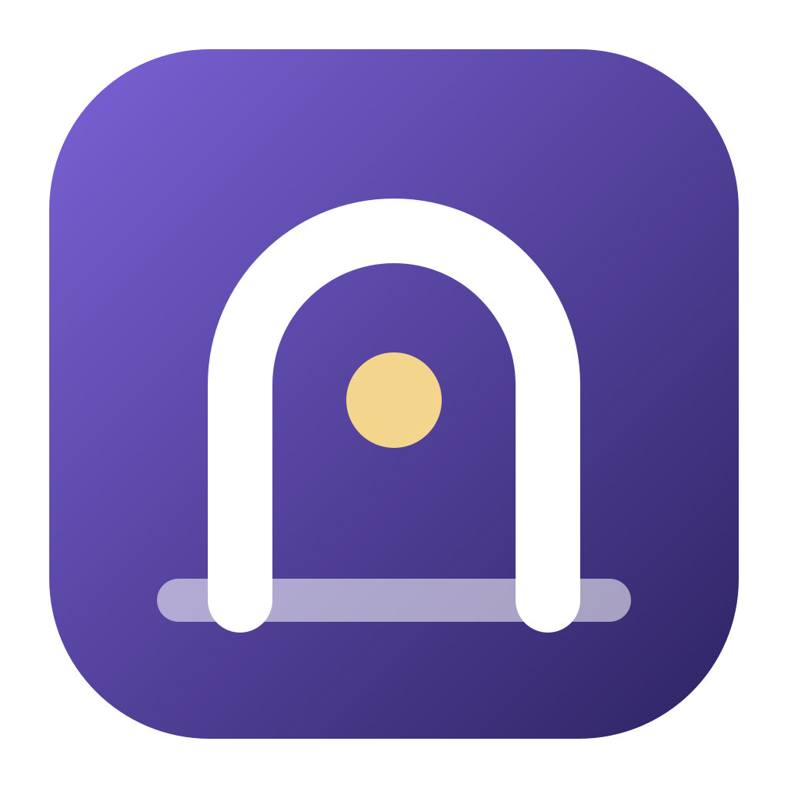
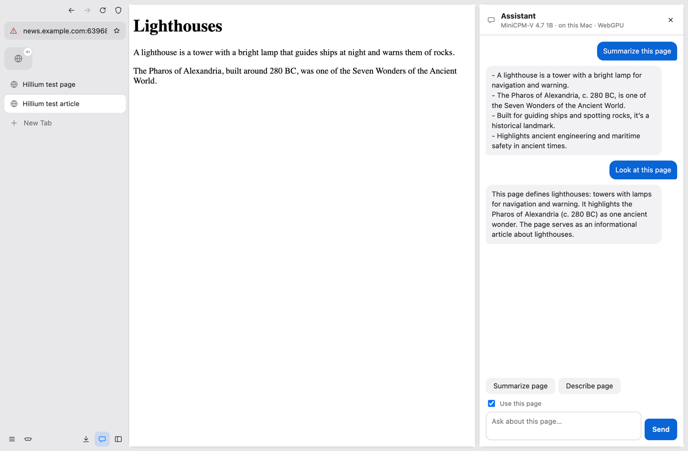
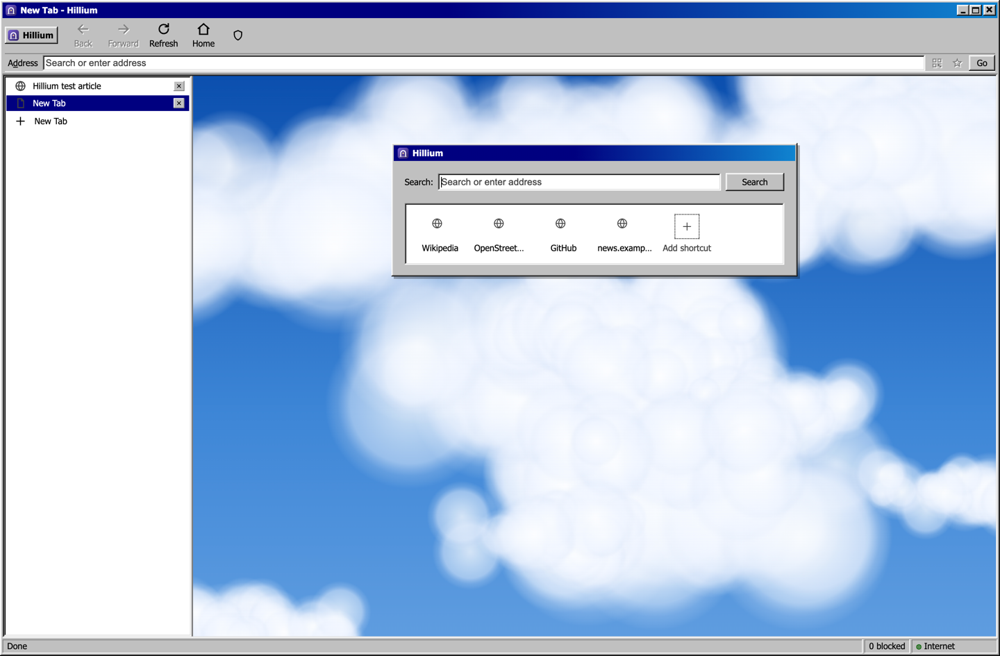
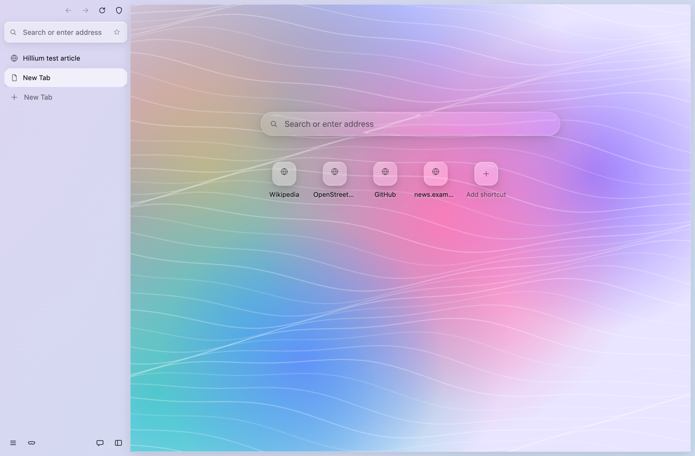

<div align="center">



# Hillium

A privacy layer for the [Helium](https://github.com/imputnet/helium) browser: offline new tab, local search, a Tor switch with a kill switch, and a URL cleaner. Plus **Hillium Browser**, a runnable browser with the same protection, three looks, Glance and a local assistant.

[Hillium Browser](#hillium-browser) · [Install](#install) · [Features](#features) · [Limits](#limits) · [Threat model](docs/threat-model.md) · [Roadmap](docs/roadmap.md) · [Contributing](CONTRIBUTING.md)

[](LICENSE)


</div>

> **Status: two ways to run it.**
> - **Hillium Browser** (`browser/`) is a Chromium shell you can run today. It has Hillium's protection built in.
> - **The companion kit** is an extension plus scripts for a stock [Helium](https://helium.computer) release.
>
> A real Helium build with Hillium compiled in is planned in the [roadmap](docs/roadmap.md).

<!-- live-links -->
**Live:** [gitguy268.github.io/hillium](https://gitguy268.github.io/hillium/) · [hillium.vercel.app](https://hillium.vercel.app)
<!-- /live-links -->

<!-- run-steps:start -->
## Run it locally, step by step

1. **Install [Node.js](https://nodejs.org) 22** or newer.

2. **Get the code:**

   ```sh
   git clone https://github.com/Gitguy268/hillium.git
   cd hillium
   ```

3. **Start Hillium Browser:**

   ```sh
   cd browser
   npm ci
   npm start
   ```

4. **Quit** by closing the window. To use the extension in Helium instead, follow the Install section below.
<!-- run-steps:end -->

## Hillium Browser

Install the release build with Homebrew (Apple silicon):

```sh
brew trust gitguy268/tap
brew install --cask gitguy268/tap/hillium
```

It's signed ad hoc, not notarised, so the cask clears the quarantine flag. Or double-click `browser/start.command` to run it from source (needs Node.js 20+). The first run installs about 350 MB.

<table>
<tr>
<td></td>
<td></td>
<td></td>
</tr>
<tr><td align="center">Normal</td><td align="center">Windows 98</td><td align="center">Liquid Glass</td></tr>
</table>

<sub>The pictures come from the test suite. In Liquid Glass, the bars sit on native macOS glass over your desktop. The test can't capture that, so a plain backdrop stands in.</sub>

| | |
|---|---|
| **Three looks** | **Normal** looks like Helium or Brave and follows light and dark mode. **Windows 98** brings a caption bar, a coolbar and a status bar. **Liquid Glass** uses native macOS glass with refracting controls |
| **Glance** | ⌃⌥Space opens a small browser in the screen corner from any app |
| **Assistant** | MiniCPM-V 4.7 1B on your Mac. It summarizes the page, answers questions about it and looks at screenshots. Private tabs are never read |
| **Focus Mode, ⌘K, flexible tabs** | Only the page (⇧⌘B). One palette for tabs, history, bookmarks and commands. Tabs on top, on the side or hidden |
| **Privacy** | Ghostery ad and tracker blocking, Hillium's URL cleaner, Tor or a proxy with a kill switch in every session, a WebRTC block, local SearXNG |

Glance, the page assistant and Focus Mode are ideas from [Web](https://github.com/nuance-dev/Web) by Nuanced. See [browser/README.md](browser/README.md) for shortcuts, the model and limits.

## Features (companion kit for Helium)

| Feature | How | Where |
|---|---|---|
| Offline new tab page | Clock, search box and quick links. It makes no network requests; favicons come from the browser's cache | `extension/` |
| Private search | [SearXNG](https://github.com/searxng/searxng) runs on your Mac at `127.0.0.1:8888` (no Docker). If it isn't running, the same search goes to a public instance | `searxng/`, `extension/` |
| URL cleaner | 27 built-in rules strip `utm_*`, `fbclid`, `gclid`, `msclkid` and other tracking parameters, offline. Once Helium services are on, uBlock Origin's AdGuard URL Tracking list adds more | `extension/url-cleaner.json` |
| Tor / proxy switch | One click routes all traffic through your own Tor (`9050`, or `9150` for Tor Browser) or any SOCKS/HTTP proxy | `extension/` |
| Kill switch | When Tor or the proxy stops, pages fail to load; they never fall back to a direct connection. The toolbar badge turns red | `extension/` |
| WebRTC leak block | Sets `disable_non_proxied_udp`. It's on by default and forced on while proxied. Switched off, it returns to Helium's default (public interface only) | `extension/` |
| Ad blocking | Helium ships uBlock Origin built in | Helium |
| Fingerprint noise | Helium adds noise to canvas, audio and `hardwareConcurrency` | Helium |
| DNS-over-HTTPS presets | Helium's Settings → Privacy → Secure DNS offers Cloudflare, NextDNS, Quad9 and Google. For Mullvad, add the custom address `https://dns.mullvad.net/dns-query` | Helium |
| Your own services | Helium's filter-list mirror, bangs and extension proxy run on your machine instead of imputnet's servers | `services/` |


## Install

You need macOS on Apple silicon or Intel, [Helium](https://github.com/imputnet/helium-macos/releases), and [Homebrew](https://brew.sh).

1. **Get the code.** Clone this repository: `git clone https://github.com/Gitguy268/hillium.git`
2. **Start local search.** Double-click `searxng/install.command`, or run:
   ```sh
   brew install uv
   sh searxng/install.sh
   ```
   SearXNG starts now and at every login. To remove it, run `searxng/uninstall.command`.
3. **Load the extension.** In Helium open `chrome://extensions`, turn on **Developer mode**, click **Load unpacked** and choose the `extension` folder.
4. **Make SearXNG the default search engine.** Go to Settings → Search engine → Manage → Add, and enter:
   - Name: `Hillium Search`
   - Shortcut: `sx`
   - URL: `http://127.0.0.1:8888/search?q=%s`

   Then choose **Make default**.
5. **For Tor:** run `brew install tor && brew services start tor`, or keep Tor Browser open and set the port to `9150`. Then pick **Tor** in the Hillium toolbar popup.

<details>
<summary><b>Optional: run Helium's services yourself</b></summary>

Helium can fetch filter lists, bangs and extensions through imputnet's servers. To use your own copy instead:

1. Install [Docker Desktop](https://www.docker.com/products/docker-desktop/) and mkcert: `brew install mkcert && mkcert -install`. The second command asks for your password once.
2. Run `sh services/run-local.sh`.
3. On Helium's first-run screen, **decline** services. Then go to Settings → Privacy → Services, set the custom origin to `https://localhost`, and only then turn services on. Doing it in this order means Helium never contacts imputnet.

[services/README.md](services/README.md) covers stopping the stack, updating it and moving it to a server.

</details>

<details>
<summary><b>How the pieces fit together</b></summary>

- **The new tab** (`newtab.html`) uses `chrome.search.query`, so typed searches go to whatever default engine you chose.
- **The background worker** (`background.js`) holds no state of its own. It reads `chrome.storage.local` and applies it on startup and after every change:
  - the proxy (`chrome.proxy`, `fixed_servers`);
  - the WebRTC policy (`chrome.privacy`);
  - DNS prefetching, which it turns off while proxied, because it could resolve hostnames outside the SOCKS proxy;
  - a redirect rule (`declarativeNetRequest`), which persists across restarts so it's in place before the worker wakes.
- **Kill switch.** Chromium never falls back to a direct connection from `fixed_servers`, so a dead Tor blocks traffic. If the stored settings are invalid, the worker points the proxy at a closed port and shows a red `!`. It does not go direct.
- **Searches in Tor mode.** Chromium never sends loopback traffic through a proxy, so local SearXNG would query Google and Bing from your real IP even in Tor mode. To prevent that, a redirect rule sends local searches to the public instance while Tor or a proxy is on, and that request goes through Tor.
- **Fallback.** If SearXNG isn't running, `webNavigation.onErrorOccurred` sends the failed search to the public instance.
- **Permissions.** The extension asks for access to all sites because Chromium only lets redirect rules (the URL cleaner and the search redirect) act on sites the extension has access to. It never reads page content and has no content scripts.

</details>

## Limits

- **Tor through a Chromium browser is not Tor Browser.** It hides your IP from sites, but your browser fingerprint still identifies you. If you need anonymity, use Tor Browser. See the [threat model](docs/threat-model.md).
- **Local SearXNG still queries Google, Bing and others from your IP**, outside Tor mode. Those engines see the queries but not your cookies or browser profile.
- **Browser video calls in Direct mode.** With the WebRTC block on, video calls in the browser may connect worse or not at all. Switch it off for calls when you aren't using Tor.
- **The proxy and WebRTC settings apply to normal windows only**, not incognito, unless you allow the extension in incognito.
- **Nothing here is compiled into the browser yet**, so the extension can be switched off from `chrome://extensions`.
- **There are no releases or auto-updates yet.** Run `git pull` and click reload on `chrome://extensions`.

## Development

```sh
node --test extension/ browser/test/*.test.js   # unit tests (no dependencies)
cd browser && npm ci && npm run e2e        # Hillium Browser end to end (Playwright)
HELIUM=/Applications/Helium.app \
PLAYWRIGHT=/path/to/node_modules/playwright/index.mjs \
node tests/e2e.mjs                         # 11 end-to-end checks in a real Helium
sh branding/make-icons.sh                  # rebuild icons from branding/logo.svg
```

The end-to-end test runs headless and needs no internet. It checks:
- the new tab override and that the new tab makes zero network requests;
- the URL cleaner;
- the search fallback and the Tor-mode search redirect;
- the WebRTC policy and DNS prefetching;
- the kill switch.

CI runs the unit tests, JSON checks and shellcheck. It does not build a browser, because a Chromium build needs paid runners.

## Credits

Hillium builds on [Helium](https://github.com/imputnet/helium) by imputnet, which builds on [ungoogled-chromium](https://github.com/ungoogled-software/ungoogled-chromium). Search is [SearXNG](https://github.com/searxng/searxng). Hillium Browser runs on [Electron](https://www.electronjs.org), blocks ads with [Ghostery's adblocker](https://github.com/ghostery/adblocker), and runs [MiniCPM-V](https://huggingface.co/openbmb/MiniCPM-V-4.7-1B-gguf) on [wllama](https://github.com/ngxson/wllama). See [NOTICE](NOTICE). Hillium is not affiliated with any of these projects, or with Google or the Tor Project.

GPL-3.0 © Lucas Van De Weerd. See [LICENSE](LICENSE).
